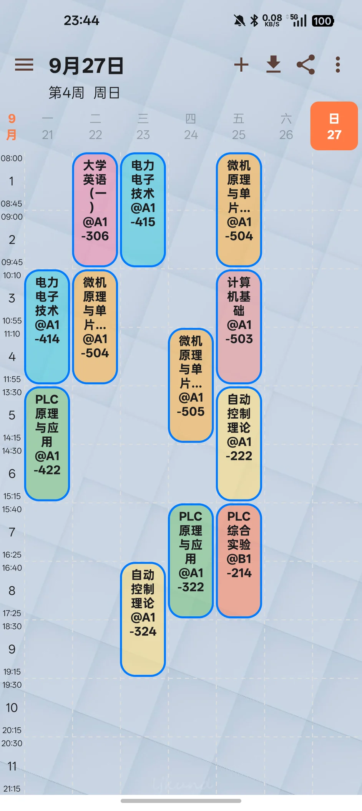
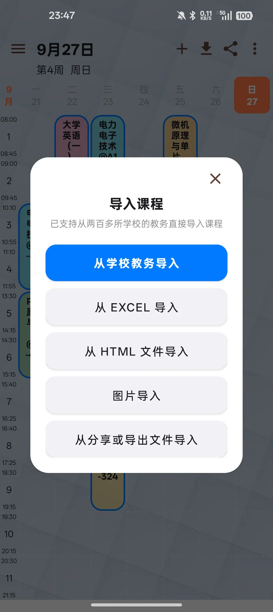
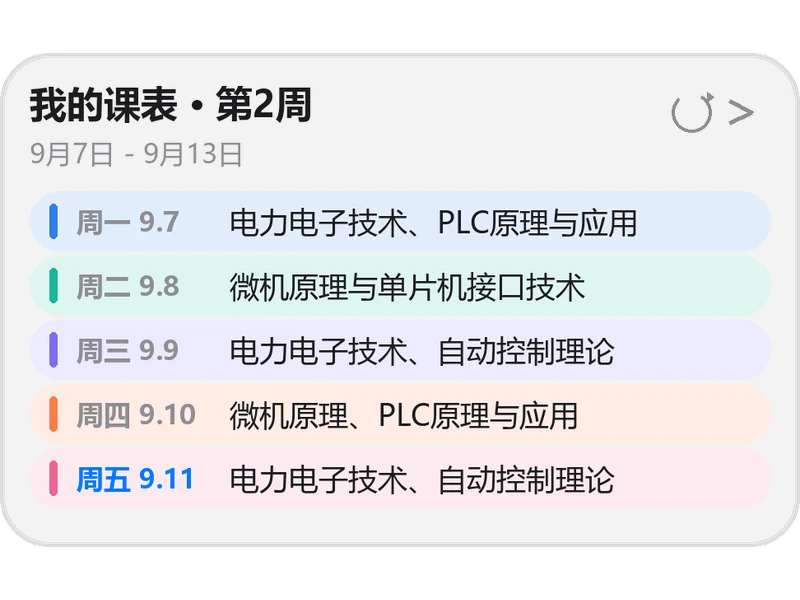

# 小唐 Tangle

> 免费、开源（Apache-2.0）、无广告的 Android 课表应用，基于 WakeUp课程表 二次开发  
> 改造重点放在**桌面小部件**与**课表交互**：玻璃质感三件套小部件、图片导入课表、拖拽排课、课表同步进系统日历

<p>
  
  
  
  
</p>

## 项目定位

小唐 Tangle 是一款给学生日常使用的课表应用，功能覆盖教务导入、课程管理、桌面小部件、上课提醒与日历同步。

它脱胎于开源的 [WakeUp课程表](https://github.com/YZune/WakeupSchedule_Kotlin)，但**不是简单换皮**：上游的桌面小部件用位图方案、刷新依赖数据库登记、图片导入不存在，这一版把这三块整体重做了，并补上了自动更新、日历同步与生日提醒。所有改动都保留上游工程结构，便于和上游对照。

坚持三件事：**不联网也能用**、**升级不丢数据**、**改了什么就写清楚**。

## 界面预览

<p align="center">以下均为真机截图（OnePlus 11，1080 × 2412）</p>

<table>
  <tr>
    <th width="50%">图 1：周课表</th>
    <th width="50%">图 2：导入课程</th>
  </tr>
  <tr>
    <td align="center"></td>
    <td align="center"></td>
  </tr>
</table>

<table>
  <tr>
    <th width="33.33%">图 3：今日课程卡</th>
    <th width="33.33%">图 4：周课表卡</th>
    <th width="33.33%">图 5：下一节课卡</th>
  </tr>
  <tr>
    <td align="center"></td>
    <td align="center"></td>
    <td align="center"></td>
  </tr>
</table>

## 核心原则

1. **免费与开源**：遵循 Apache License 2.0，上游的 `LICENSE` 与版权声明完整保留。
2. **零干扰**：无广告、无会员、无非必要推送，也不做注册登录。
3. **本地优先**：图片导入走本机离线 OCR，课表与截图都不出设备，核心功能断网可用。
4. **升级不丢数据**：固定签名 + 同包名，新版直接覆盖安装，不必卸载。
5. **改动可追溯**：每一版都写进 README 与 [CHANGELOG.md](CHANGELOG.md)，踩过的坑记在代码注释里。

## 主要功能

### 桌面小部件（改造重点）

- **今日课程卡**：当天课程按时间顺序铺开，**正在上的课高亮并标「正在上」**，可渲染行数按屏幕方向取值
- **周课表卡**：一周课程按天汇总，右上角带加课入口
- **下一节课卡**：显示下一节课的名称、时间与教室，临近上课显示倒计时
- 三个部件都改成**高度自适应 + 玻璃卡外观**，弃用上游的位图方案
- **空态显示短句**，不再卡在「加载中」
- 刷新改按系统 `appWidgetIds` 走，不再依赖数据库登记

### 课表与交互

- 周视图/日视图切换，左右滑动换周，多课表管理与周数切换
- **长按拖拽移动课程**，支持撤销
- 同名课程颜色自动对齐
- 长课名限 4 行加省略号，「@教室」不再被顶出格子

### 课程导入

- **从学校教务导入**：内置两百多所学校的教务模板
- **图片导入**：课表截图直接识别成课表，本机离线 OCR（Tesseract 5.x + 简体中文训练数据），**不联网、不上传图片**，识别结果先展示确认再写库
- 从 EXCEL 导入 / 从 HTML 文件导入 / 从分享或导出文件导入

### 提醒与系统日历

- 课表同步进系统日历：**每节课一条**（提前 15 分钟提醒）
- 每天一条「每日课表」整天汇总，与周课表互补
- 手机里查不到可写入日历时，**自动建一个「小唐Tangle课表」本地日历**再写入，不用先去日历 App 手工建

### 自动更新与安装

- 启动后自动检查 GitHub 最新版，弹窗提示并支持**一键下载安装**，不必手动跑一趟 Releases；关于页可手动检查
- 下载三层校验：`Content-Type`（挡镜像站的 HTML 报错页）→ `Content-Length`（挡被截断的响应）→ `sha256`（对 GitHub 提供的摘要）
- 安装前比对**包名与签名**，不一致就不引导安装，避免用户被诱导卸载导致数据丢失
- 下载好的包会留档，下次冷启动可继续安装，不必重新下载

### 贴心功能

- 生日提醒板块：当天课程上完后出现在今日卡底部
- 课程预告范围设置

## 这个版本改了什么

**当前版本：v166 / 3.697**（2026-09-27，发布前全量排查修复 102 项 + 生日滚轮崩溃根治）

| 方向 | 内容 |
| --- | --- |
| **生日滚轮崩溃修复** | **修掉生日页「日」滚轮选 2 月 29 日时的进程级崩溃**：系统 `NumberPicker` 的无障碍「加号」按钮按「当前值 + 1」去数组里取文本，而**是否真的取索引只看 `value < maxValue`**。当「日」轮停在旧上限（2 月 29 天）时切到 3 月，上限先被改成 31（判断放行）但数组还是 2 月那 29 个元素，于是越界；异常发生在**框架无障碍回调**里，`try/catch` 和崩溃日志都接不住。修法是把「赋值 → 换数组 → 改上限」的顺序调整成**每一步之后的中间状态都自洽**，从机制上消除矛盾窗口 |
| **发布前全量排查修复** | **对全工程做了 109 条缺陷排查、落地修复 102 条（严重级清零）**：修掉冷启动竞态（进课表管理 1 秒内点「+」会崩）、4 个页面「点了没反应」的静默功能损坏、自动更新取消/失败后的通知与残留文件、五种教务模板的导入容错、超大 HTML 的内存上限、外部 Intent 改写导入地址等安全问题、精确闹钟授权状态显示不一致、深色模式标题栏对比度不足（实测 1.09，改后 21.0）等；并让 **release 包首次能编出来且 R8 跑通**（裁掉 2.18 万行代码，体积比 debug 小约 27%）|
| **今日卡行数修复** | **修掉「标题写共 2 门课，却只渲染 1 门」**：卡片高度此前不分方向统一按 `MAX_HEIGHT` 取，竖屏下该值偏小导致可渲染行数被低估；现按屏幕方向取值（竖屏 `MAX_HEIGHT` / 横屏 `MIN_HEIGHT`），另一侧作回退。同时修掉生日板块因空间不足被隐藏时**没有恢复**此前为它让位的课程行，避免「生日没显示、课也少了一门」的双重丢行 |
| 桌面小部件 | 今日课程卡、周课表卡、下一节课卡三个部件全部重做：去掉位图方案、高度自适应、玻璃卡外观、空态短句 |
| 刷新机制 | 修掉「小卡片更新不了课表」的根因，刷新不再依赖数据库登记，改按系统 `appWidgetIds` 走 |
| 交互增强 | 课表网格内长按拖拽移动课程（可撤销）、周课表卡右上角加课入口、同名课程颜色自动对齐 |
| **图片导入** | **课表截图直接识别成课表**：本机离线 OCR，不联网、不上传图片；识别结果先展示确认再写库 |
| 负一屏 / 日历 | 课表可同步进系统日历：每节课一条（提前 15 分钟提醒）+ 每天一条「每日课表」整天汇总，周课表和每日课表互补 |
| 贴心功能 | 生日提醒板块（今天课上完后出现在今日卡底部）、课程预告范围设置 |
| 安装升级 | APK 固定签名，新版可直接覆盖安装，不必卸载、课表数据不会丢 |
| **内置自动更新** | **启动后自动检查 GitHub 最新版，发现新版本弹窗提示并支持一键下载安装，无需手动去 GitHub；无网络 / 已最新 / 下载失败都有友好提示，关于页可手动检查** |
| 问题修复 | 修掉设置生日时误跳到「选择时间表」的问题（快捷指令被重复执行） |
| **生日页修复** | **拨生日「月」滚轮不再整页退出到课表设置**：滚轮贴着屏幕左缘，竖滑被系统边缘返回手势抢走；已把滚轮区从手势判定区排除 |
| **负一屏 / 日历修复** | **修掉「负一屏课程卡没有课」**：新版 ColorOS 把日历数据搬进了私有库（com.coloros.calendar），同步还写在原生库上等于写进空库；已改为自动探测 Provider，读写全程走同一个库 |
| **日历自动创建** | 手机里查不到可写入的日历时，**自动建一个「小唐Tangle课表」本地日历**再写入，不再要求你先去日历 App 里手工建；反复同步都能用 |
| **课名排版修复** | 长课名不再把「@教室」顶出格子：教室行按实际行数留位，课名限 4 行加省略号 |
| 导入修复 | 茅台学院等新版教务「导入不全」：自动展开「更多」的完整课表视图后再抓取；每次导入留档原始页面便于排查 |

完整的版本演进、每一版做了什么、踩过哪些坑，见 [CHANGELOG.md](CHANGELOG.md)。

## 下载

安装包放在 [Releases](https://github.com/Fuhanglio/XiaoTang-Tangle/releases) 里，每个版本一个 APK：

- [**最新版（v166 / 3.697）**](https://github.com/Fuhanglio/XiaoTang-Tangle/releases/latest)
- [全部历史版本](https://github.com/Fuhanglio/XiaoTang-Tangle/releases)

安装前需在「设置 → 关于本机」里连点版本号开启开发者选项，并允许安装未知来源应用。若已装过旧版，直接覆盖安装即可，课表数据不会丢。

## 常见问题（FAQ）

- **升级会不会把课表弄丢？**  
  不会。APK 使用固定签名，包名也不变，新版直接覆盖安装即可。**请不要卸载后重装**，卸载会清掉应用数据。

- **图片导入会把我的课表传到服务器吗？**  
  不会。识别在本机离线完成（Tesseract OCR），图片不上传，识别结果只在你点确认后写入本地数据库。

- **支持哪些学校的教务？**  
  内置两百多所学校的模板。不在列表里时，可以用图片导入课表截图，或先用浏览器打开教务页面保存为 HTML 再导入。

- **自动更新点了没反应？**  
  先确认已允许「安装未知来源应用」。下载失败时应用会明确提示原因（网络不通、校验不通过等），也可以到关于页手动检查更新。

- **为什么常驻通知里有更新提示？**  
  下载过程由前台服务承载，通知用来展示进度与失败原因，下载结束会自动撤销。

## 开发者

### 环境要求

- **JDK**：17（AGP 8.1.4 的最低要求）
- **Gradle**：8.7（`gradlew` 已把分发地址指向腾讯云镜像）
- **Android SDK**：Platform 34（`compileSdk` / `targetSdk` 均为 34，`minSdk` 21）

### 构建

```bash
git clone git@github.com:Fuhanglio/XiaoTang-Tangle.git
cd XiaoTang-Tangle
./gradlew assembleRelease
```

签名通过根目录 `keystore.properties` 读取。`keystore/` 与 `keystore.properties` **都不入库**（含私钥，是保证已装应用能覆盖升级的关键文件），本地构建需自备。

### 项目结构

`app/src/main/java/com/Tangle/timetable/` 下按功能分层，204 个 Kotlin 文件，无 Java 文件：

```text
com/Tangle/timetable/
├── SplashActivity.kt        # 冷启动：清理残留分片、提示上次已下载好的更新
├── schedule/                # 课表主界面：周视图/日视图、拖拽排课
├── schedule_import/         # 导入：教务 / EXCEL / HTML / 图片(OCR) / 分享文件
├── schedule_manage/         # 多课表管理、周数切换
├── schedule_settings/       # 课表级设置
├── settings/                # 设置宿主页（SettingsHostActivity）
├── today_appwidget/         # 今日课程卡
├── schedule_appwidget/      # 周课表卡
├── next_appwidget/          # 下一节课卡
├── widget/                  # 小部件公共渲染与自适应布局
├── update/                  # 自动更新：检查、下载服务、校验、待装包留档
├── utils/                   # 日历同步、迁移等工具
├── bean/  dao/              # Room 实体与 DAO
└── base_view/  course_add/  intro/  suda_life/
```

### 技术栈与版本

以下版本以仓库默认配置为准，最终来源是 `build.gradle` 与 `app/build.gradle`。

- **语言**：Kotlin 1.9.22（JVM target 1.8，兼容低版本设备）
- **构建**：AGP 8.1.4 + Gradle 8.7
- **视图**：ViewBinding + Navigation 2.7.7（safeargs）
- **数据库**：Room 2.6.1（kapt）
- **后台任务**：WorkManager 2.9.0
- **网络**：Retrofit 2.7.1 + OkHttp 4.12.0（仅用于检查更新与导入解析）
- **HTML 解析**：jsoup 1.17.2
- **OCR**：`app/libs/tesseract4android-4.8.0-jdk8.jar`（Tesseract 5.x 精简打包，仅保留 armeabi-v7a / arm64-v8a）
- **协程**：kotlinx-coroutines 1.7.1
- **其他**：Glide 4.11.0、Gson 2.9.0、Material 1.9.0、NumberPickerView 1.2.0、Toasty

## 来源与声明

- 上游项目：[YZune/WakeupSchedule_Kotlin](https://github.com/YZune/WakeupSchedule_Kotlin)（WakeUp课程表，作者 YZune / 杨增）
- 上游许可：Apache License 2.0。原 `LICENSE` 与版权声明完整保留
- 本仓库是在上游源码基础上的二次开发版本，特此声明

上游作者在 README 中写道：「开源旨在可以降低后来者的门槛，借鉴可以，但是希望在相关 App 中能有所声明。」据此，本仓库在此明确标注来源与二次开发的事实。

### v167 后台刷新功耗优化

v167（3.698）把"固定周期轮询"换成三道闸门：

1. **触发闸门**（`WidgetRefreshPolicy`）：亮屏、WorkManager、20:00 预告、倒计时窗口进门前先问"内容真的变了吗"，无课日 / 课后 / 24h 内已刷过时秒退。
2. **内容指纹闸**（`WidgetFingerprint`）：每次 `updateAppWidget` 前算一遍 RemoteViews 的内容指纹（周卡的天/课程/颜色、今日卡的课/空态/生日、下一节课卡的课/倒计时 bucket），与上次一样就不下发。
3. **可延迟闹钟**：00:05 跨天重算、20:00 预告、下一节课倒计时 tick 全部改 `setAlarmAllowIdle()`（API 21/22 降级为 `set()`），不再用精确闹钟；WorkManager 周期从 30 分钟拉到 180 分钟 + `ExistingPeriodicWorkPolicy.UPDATE`；Widget XML 的 `updatePeriodMillis` 砍到 0/0/6h。

课程开始/结束闹钟、课前提醒通知的精确闹钟链路 **完全保留**（`canScheduleExact` 降级逻辑不动）。不改变任何用户可见功能。详细改动见 [CHANGELOG.md](./CHANGELOG.md)。

---

# 上游 README（WakeUp课程表 3.612）

[Google Play 下载](https://play.google.com/store/apps/details?id=com.suda.yzune.wakeupschedule.pro) | [酷安下载](https://www.coolapk.com/apk/159120)

## 声明

开源旨在可以降低后来者的门槛，借鉴可以，但是希望在相关 App 中能有所声明。

教务网页解析的部分单独抽出了一个库，见 [CourseAdapter](https://github.com/YZune/CourseAdapter)

近期要忙于毕设，欢迎大佬们 PR

## 上架情况

截至2020.02.10

- 酷安[√] 19万
- 应用宝[√] 12674
- 魅族应用商店[√] 21590
- 小米应用商店[√] 61799
- OPPO应用商店[√] 19.3万
- VIVO应用商店[√] 23万
- 华为应用商店[√] 51.9万

## 开源相关

### 集成的开源库

- AndroidX 项目
- [Kotlin](https://github.com/JetBrains/kotlin)
- [Material Design](https://github.com/material-components/material-components-android)
- [Retrofit2](https://github.com/square/retrofit)
- [Toasty](https://github.com/GrenderG/Toasty)
- [jsoup](https://github.com/jhy/jsoup)
- [NumberPickerView](https://github.com/Carbs0126/NumberPickerView)
- [BaseRecyclerViewAdapterHelper](https://github.com/CymChad/BaseRecyclerViewAdapterHelper)
- [ColorPicker](https://github.com/jaredrummler/ColorPicker)
- [Glide](https://github.com/bumptech/glide)
- [Gson](https://github.com/google/gson)
- [kotlin-csv](https://github.com/doyaaaaaken/kotlin-csv)
- [TextDrawable](https://github.com/jahirfiquitiva/TextDrawable)
- [Android-QuickSideBar](https://github.com/saiwu-bigkoo/Android-QuickSideBar/)
- [sticky-headers-recyclerview](https://github.com/timehop/sticky-headers-recyclerview)
- [biweekly](https://github.com/mangstadt/biweekly)
- [appcenter-sdk-android](https://github.com/microsoft/appcenter-sdk-android)

### 参考项目

苏大的正方教务模拟登录和课程解析部分参考了[另一个课程表项目](https://github.com/mnnyang/ClassSchedule)，不过我对课程解析部分改动非常大，导入更为准确。

## TODO

- 集成“咩咩”
- 支持课程笔记
- 直接写入系统日历
- ~~完善对方正教务课程的解析~~
- 适配已经提交数据的学校
- ~~数据备份和恢复（用课程文件导出导入实现了，还支持分享）~~
- ~~课程分享~~
- ~~增加对夏冬令时的支持（可以设置任意数量的时间表）~~
- 注册登录，小范围的社交，主要是为社团的活动服务
- 完全迁移至AndroidX
- 国际化

## License

```
Copyright 2019 YZune. https://github.com/YZune

Licensed under the Apache License, Version 2.0 (the "License");
you may not use this file except in compliance with the License.
You may obtain a copy of the License at

   http://www.apache.org/licenses/LICENSE-2.0

Unless required by applicable law or agreed to in writing, software
distributed under the License is distributed on an "AS IS" BASIS,
WITHOUT WARRANTIES OR CONDITIONS OF ANY KIND, either express or implied.
See the License for the specific language governing permissions and
 limitations under the License.
 ```